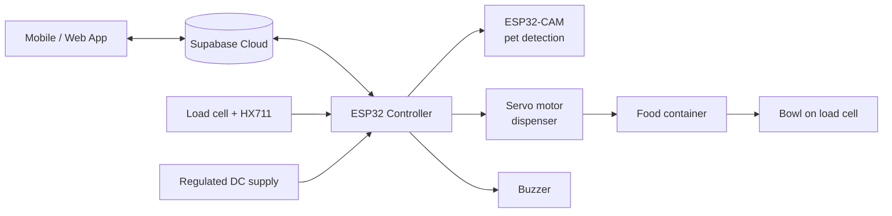

# 🐾 Smart Pet Feeder

An IoT-based automatic pet feeder that **calls the pet, confirms it is present with a camera, dispenses a weighed portion, and then checks whether the food was actually eaten** — all controllable from a web/mobile app.

> B.Tech Mini Project (2025-26), Department of Electronics and Communication Engineering,
> Rajiv Gandhi Institute of Technology (RIT), Kottayam — APJ Abdul Kalam Technological University.

## ✨ Features

- **Scheduled feeding** with portion size set from the app
- **Pet-first logic:** buzzer calls the pet, then a 10-minute window waits for the pet before dispensing
- **Weight-based portion control** using a load cell + HX711 (dispenses until target grams, 15 s safety timeout)
- **Post-feeding monitoring:** after 30 min, alerts the owner if the food level has barely dropped
- **Missed-meal alerts** if the pet never arrives
- **Remote control:** manual feed and scale tare (calibration) from the dashboard
- **Cloud logging** of every session (time, grams dispensed, pet detected)
- **Pet profile setup** with veterinary calorie formula: `RER = 70 × W^0.75`, daily need = RER × 1.6 (MER factor)

## 🧩 System Architecture



### Feeding flow

1. Time reaches the schedule (or the app sends a manual trigger)
2. Buzzer sounds for 1 s
3. Camera checks for the pet for up to 10 min
4. Pet seen (or manual override) → servo opens, load cell measures until target weight reached
5. Session logged to cloud; 30-min consumption check starts
6. No pet → "pet did not arrive" alert + failed session logged

## 🔧 Hardware

| Component | Purpose |
|---|---|
| ESP32 development board | Main controller, Wi-Fi |
| ESP32-CAM (AI-Thinker, OV-series camera) | Pet presence detection / monitoring |
| Servo motor (MG996R) | Food dispensing gate |
| Load cell + HX711 amplifier | Portion and consumption measurement |
| Buzzer | Calls the pet |
| Regulated DC adapter | Power |

### Pin map (as in firmware)

| Signal | GPIO |
|---|---|
| Servo | 13 |
| Buzzer | 19 |
| HX711 DOUT | 15 |
| HX711 SCK | 14 |

Camera pins follow the AI-Thinker ESP32-CAM layout (see the `.ino`).

## 💻 Software & Services

- Arduino IDE (ESP32 board package)
- Libraries: `ESP32Servo`, `HX711`, `ArduinoJson`, `esp_camera` (ESP32 core)
- **Supabase** (Postgres + REST) as the cloud backend
- **Lovable** for the dashboard UI (Dashboard, My Pets, Schedule, History, Alerts, Settings)

## 🚀 Getting Started

1. **Clone** this repo.
2. **Database:** create a Supabase project and run [`database/schema.sql`](database/schema.sql). Enable Row Level Security and add policies.
3. **Secrets:** in `firmware/smart_pet_feeder/`, copy `secrets.h.example` to `secrets.h` and fill in Wi-Fi + Supabase URL/anon key.
4. **Calibrate** the load cell (default `calibration_factor = -130.0`; yours will differ).
5. Open `smart_pet_feeder.ino` in Arduino IDE, select your ESP32 board, upload.
6. Open the app, create a pet profile and a schedule. The device polls the schedule every ~5 s.

## 📁 Repository Structure

```
smart-pet-feeder/
├── firmware/smart_pet_feeder/
│   ├── smart_pet_feeder.ino
│   └── secrets.h.example
├── database/schema.sql
├── docs/            # report, presentation, images
├── .gitignore
├── SECURITY.md
├── LICENSE
└── README.md
```

## ⚠️ Current Status & Known Limitations

Being upfront so others can build on this:

- **Pet detection is a placeholder.** `detectPetPresence()` captures a frame but currently returns `true` (simulation). Real detection needs an Edge Impulse (or similar) model.
- **GPIO19 conflict:** the buzzer uses GPIO19, which is also camera data line D2 in the camera config. Move the buzzer to a free pin if both run on the same board.
- **Blocking waits:** the 10-minute detection loop blocks `loop()`, so cloud sync pauses during it.
- **Security:** the device uses the Supabase anon key; RLS policies are provided in `database/schema.sql`. See [SECURITY.md](SECURITY.md).
- Timezone is hard-coded to IST (UTC+5:30).

## 🔮 Future Work

- On-device AI pet recognition (Edge Impulse / TinyML)
- Image upload to cloud and live camera view in the app
- Feeding-behaviour analytics (normal / partial / missed classification)
- Non-blocking state machine, OTA updates, multi-pet support


## 📄 License

MIT — see [LICENSE](LICENSE).
